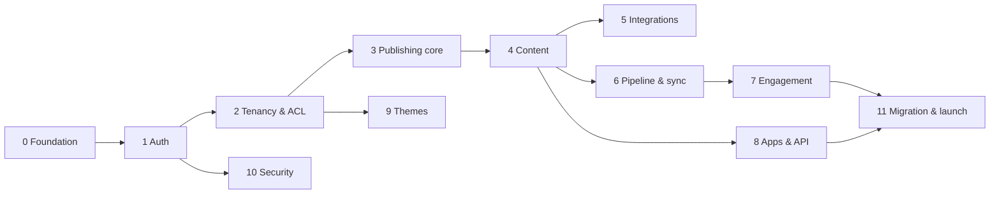

# SBBlog v2 — Console delivery plan

The console is the admin app: Laravel 13 + Inertia 3 + React 19, the write side of the
[ERD](./erd.md). This plan covers the full v2 scope as a sequence of phases. Each task is meant
to fit in one PR.

**Status:** the data layer and **phases 0–10 are done** (foundation, authentication, tenancy and
access control, publishing core, content, integrations, publishing pipeline, engagement, apps and
API, themes, security hardening; see [security.md](security.md)), followed by 20 review cycles for
phases 0–6. Kafka, NATS and Redis transports are stubbed (webhook only). Next: phase 11 (v1
import and launch).

## Decisions

| Topic           | Decision                                                                                                                                                                                                       |
| --------------- | -------------------------------------------------------------------------------------------------------------------------------------------------------------------------------------------------------------- |
| UI kit          | **shadcn/ui** (Radix + Tailwind 4). Components go in `resources/js/components/ui`, which the linter already ignores.                                                                                           |
| Auth            | **Our own controllers**, with no Fortify or Breeze. Includes session login, password reset, email verification and invites. 2FA (TOTP) and passkeys come in phase 10 and use the `users.two_factor_*` columns. |
| i18n            | **From day one, pt-BR by default** and en-US as the second language. No string is hard-coded in a component or in a validation message.                                                                        |
| Routes in TS    | **Wayfinder** (already installed). The frontend never hard-codes a URL.                                                                                                                                        |
| Package manager | **pnpm** (`pnpm-workspace.yaml` is already in the repo).                                                                                                                                                       |
| Hosting | **Console and API on the same host**: console at `/`, `/api/v1` for apps, `/api/sync` (plus comment ingest) for blog frontends. Session cookies stay same-origin; only the frontend-facing endpoints need CORS. |
| Billing | **Not in 2.0; planned for 2.6** (see Roadmap). Features that depend on a paid plan move with it. |
| Analytics | **The blog's own analytics tool** (Google Analytics etc. via integrations). No page-view storage on our side; the scripts loader sends article, author and category as custom dimensions. |
| Article body | **Tiptap (ProseMirror) JSON**, stored in `article_revisions.body`. Validated server-side against an allow-list of nodes and marks. Images reference media by ID. `@sbblog/core` renders it to HTML. |
| Tests           | Pest/PHPUnit on PostgreSQL. Every task ships with feature tests for its endpoints and policies.                                                                                                                |

## Conventions (apply to every task)

- **URL shape:** `/{workspace:slug}/{blog:slug}/…` for blog-scoped pages and `/{workspace:slug}/settings/…`
  for workspace pages. Account pages live under `/account/…` and auth pages at the root.
- **Tenant resolution:** an `EnsureTenant` middleware binds the current workspace and blog, returns
  404 when the user is not a member (never 403, so membership doesn't leak), and shares
  `currentWorkspace`, `currentBlog` and `can` (the permission keys for that blog) as Inertia props.
- **Writes** go through action classes (`app/Actions/...`), never controllers alone. Any
  publish-relevant action calls `EventRecorder` in the same DB transaction (ERD rule 5).
- **Audit:** every write in settings, members, roles, integrations, apps or security calls
  `AuditLogger`.
- **Frontend structure:** `pages/` mirrors routes, with `layouts/` (auth, console, settings),
  `components/ui` (shadcn), `components/app` (our components), `hooks/`, `lib/` and `i18n/`.
- **Forms** use the Inertia `<Form>`/`useForm` components with Form Request validation, and
  validation messages are translated.
- **Lists** are server-side: pagination, sorting and filters as query string, a shared `DataTable`
  built on `@tanstack/react-table`, and empty and loading states.
- **Done means:** lint + types + PHPStan level 7 + tests are green, the UI works in light and dark
  mode and on mobile width, and every string has a pt-BR and en-US translation.

---

## Phase 0 — Frontend foundation

| ID   | Task                | Notes / acceptance                                                                                                                                                                                                                                                                                                                                                                              |
| ---- | ------------------- | ----------------------------------------------------------------------------------------------------------------------------------------------------------------------------------------------------------------------------------------------------------------------------------------------------------------------------------------------------------------------------------------------- |
| F-01 | Tooling bootstrap   | `pnpm install`, `pnpm build` working, `composer ci:check` green in CI (GitHub Actions running a Postgres service). Also fixes the pre-existing `ExampleTest` and the `config/sanctum.php` PHPStan error.                                                                                                                                                                                        |
| F-02 | shadcn/ui setup     | `components.json`, theme tokens in `app.css` (light/dark), base components: button, input, label, textarea, select, checkbox, switch, dialog, sheet, dropdown-menu, popover, command, tooltip, badge, card, table, tabs, separator, skeleton, sonner (toasts), avatar, breadcrumb, sidebar.                                                                                                     |
| F-03 | Appearance          | Light/dark/system toggle stored in a cookie and applied server-side in `app.blade.php` (no flash on load).                                                                                                                                                                                                                                                                                      |
| F-04 | i18n infrastructure | `SetLocale` middleware picks the language from `users.language_id`, then `Accept-Language`, then `pt-BR`. Translations live in `lang/{pt-BR,en-US}.json`, are shared by Laravel and React (loaded with `import.meta.glob`), and are used through a `useTranslation()` hook with interpolation and plurals. Dates and numbers are formatted with `Intl`, and validation messages are translated. |
| F-05 | Layouts             | `AuthLayout` and `ConsoleLayout`: sidebar (collapsible state in a cookie and the `sidebarOpen` prop), top bar with breadcrumbs, user menu, workspace/blog switcher slot, and a toast area wired to flash messages.                                                                                                                                                                              |
| F-06 | App primitives      | `DataTable` (server pagination/sort/filter), `ConfirmDialog`, `EmptyState`, `PageHeader`, `FormField` (label + error), `SlugInput` (auto-generate + edit), `ColorInput`, `DateTimeInput` (timezone-aware), `Can` component and `useCan()` hook.                                                                                                                                                 |
| F-07 | Error pages         | Inertia 403/404/419/500/503 pages, translated.                                                                                                                                                                                                                                                                                                                                                  |

## Phase 1 — Authentication & account (own controllers)

| ID   | Task                  | Notes / acceptance                                                                                                                                                           |
| ---- | --------------------- | ---------------------------------------------------------------------------------------------------------------------------------------------------------------------------- |
| A-01 | Login / logout        | Session guard, "remember me", rate limited by email+IP (5/min), session regenerated on login, `last_login_at` updated, failed and successful logins written to `audit_logs`. |
| A-02 | Password reset        | Forgot/reset with Laravel's password broker. Translated mail. The response is the same whether or not the email exists.                                                      |
| A-03 | Email verification    | Signed link, resend with throttle, and a `verified` middleware on the console.                                                                                               |
| A-04 | Account settings      | Profile (name, email with re-verification, interface language), password change (requires the current password), and active sessions listing with "log out other devices".   |
| A-05 | Password confirmation | `password.confirm` middleware reused by sensitive actions (members, roles, tokens, raw scripts, account deletion).                                                           |
| A-06 | Account deletion      | Soft delete with confirmation. Blocked while the user owns a workspace (transfer ownership first).                                                                           |

## Phase 2 — Tenancy & access control

| ID   | Task                          | Notes / acceptance                                                                                                                                                                                                                                            |
| ---- | ----------------------------- | ------------------------------------------------------------------------------------------------------------------------------------------------------------------------------------------------------------------------------------------------------------- |
| T-01 | Onboarding                    | First login with no workspace leads to creating a workspace, then a first blog (name, slug, default language).                                                                                                                                                |
| T-02 | Workspace & blog switcher     | Lists the workspaces and blogs the user belongs to, remembers the last one used, and redirects `/` to it.                                                                                                                                                     |
| T-03 | `EnsureTenant` + shared props | As described in Conventions. Covered by tests for non-members (404) and soft-deleted blogs.                                                                                                                                                                   |
| T-04 | Permission resolver           | `PermissionResolver::for(User, Blog)` gives workspace role + blog role → permission keys, cached per request. A `Gate::before` hook maps abilities to permission keys, and policies exist for every model. The workspace `owner` always has every permission. |
| T-05 | 2FA enforcement hook          | `RequiresTwoFactor` checks the workspace policy, then the role flag, then the permission flag (ERD §2). Until phase 10 ships, users without 2FA are blocked from those actions with a clear message.                                                          |
| T-06 | Workspace settings            | Name, slug, two-factor policy, plan (read-only), and delete workspace with type-to-confirm.                                                                                                                                                                   |
| T-07 | Blog settings                 | General settings (name, slug, title, slogan, description, canonical URL, brand image, `autoconvert_webp`), languages (`blog_languages` plus the default language), comment policy, and delete/restore blog.                                                   |
| T-08 | Members & invites             | Invite by email with a role and a signed, expiring link. Invites to unregistered emails lead to sign-up and then join. Also covers changing roles, removing members and transferring workspace ownership. Needs an `invitations` table (new migration).       |
| T-09 | Roles | Lists the 7 built-in roles (read-only) with their permission matrix grouped by `permissions.group`. Custom roles move to 2.6 with billing. |
| T-10 | Audit log viewer              | Filters by actor, action, subject and date, scoped to the workspace or blog, gated by `audit.view`.                                                                                                                                                           |

## Phase 3 — Publishing core (backend, needed before content)

| ID   | Task                      | Notes / acceptance                                                                                                                                                                                                                                                                             |
| ---- | ------------------------- | ---------------------------------------------------------------------------------------------------------------------------------------------------------------------------------------------------------------------------------------------------------------------------------------------- |
| P-01 | `EventRecorder`           | Runs inside the caller's transaction. It locks the blog row with `SELECT … FOR UPDATE`, increments `event_sequence`, and inserts into `outbox_events`. Tests show sequences stay gapless and ordered under concurrent writers.                                                                 |
| P-02 | Event catalog & schemas   | A typed event class per type (`article.published`, `article.unpublished`, `article.deleted`, `category.*`, `tag.*`, `author.*`, `media.*`, `blog.updated`, `integrations.updated`, `comment.approved`, `theme.updated`…), each with a `schema_version` and a JSON Schema in `docs/v2/events/`. |
| P-03 | Snapshot payload builders | Build the full rendered payload for each aggregate (article + author + category + tags + media URLs). This is shared with `@sbblog/core`.                                                                                                                                                      |
| P-04 | Body schema | Define the allowed Tiptap nodes and marks (paragraph, heading 2–4, lists, quote, code block, image by `mediaId`, embed, table, link, bold/italic/code…) as a JSON Schema in `docs/v2/events/`, a PHP validator, and a PHP renderer to HTML for previews and payloads. Shared with `@sbblog/core`. |

## Phase 4 — Content

| ID   | Task              | Notes / acceptance                                                                                                                                                                                                                                                                                                                                                                                                                          |
| ---- | ----------------- | ------------------------------------------------------------------------------------------------------------------------------------------------------------------------------------------------------------------------------------------------------------------------------------------------------------------------------------------------------------------------------------------------------------------------------------------- |
| C-01 | Media library     | Upload (drag & drop, multiple files, size/MIME limits), a grid with search, alt text editing, a delete guard when the file is in use, and a `MediaPicker` dialog reused everywhere. A queued job reads dimensions, computes the checksum (to dedupe), and generates WebP and thumbnail variants when `autoconvert_webp` is on. Disks: `local`, `s3`, `r2`. Emits `media.updated`/`media.deleted`.                                           |
| C-02 | Categories        | Tree CRUD with parent, drag-to-reorder (`position`), color, and soft delete/restore. Deleting a category moves its articles to "no category" after confirmation. Emits events.                                                                                                                                                                                                                                                              |
| C-03 | Tags              | CRUD, merge two tags, and a slug that is unique per blog. Creating tags inline from the article editor reuses the same action.                                                                                                                                                                                                                                                                                                              |
| C-04 | Author profiles   | CRUD that links a member user or creates a guest author, with bio, avatar (`MediaPicker`) and social links (`social_links` with `author_profile_id`). A member's profile is created automatically when they first write.                                                                                                                                                                                                                    |
| C-05 | Blog social links | Per-network URL editor (`social_links` with `author_profile_id` null).                                                                                                                                                                                                                                                                                                                                                                      |
| C-06 | Article list      | Filters (status, author, category, language, tag, search) and status badges, with bulk archive/delete/restore actions and a trash view for soft-deleted articles.                                                                                                                                                                                                                                                                           |
| C-07 | Article editor    | Tiptap editor (headings, lists, quotes, code, images from `MediaPicker`, embeds, tables). Side panel for slug, category, tags, author, cover, meta description and bgcolor. Autosave produces a **new immutable revision** (debounced and coalesced, so it isn't one revision per keystroke). Warns before leaving with unsaved changes. Preview uses the PHP renderer.                                                                     |
| C-08 | Revisions         | History with author/app/date, a diff between any two revisions, and "restore" (creates a new revision copied from an old one).                                                                                                                                                                                                                                                                                                              |
| C-09 | Publish workflow  | Draft → in_review → scheduled/published → archived. Publishing sets `published_revision_id = current_revision_id` and emits `article.published` with the payload. Unpublishing and archiving emit their own events. Gated by `articles.publish`.                                                                                                                                                                                            |
| C-10 | Scheduling        | Pick a date and time in the user's timezone. A scheduler job (every minute, `withoutOverlapping`) publishes due articles through the same action as C-09.                                                                                                                                                                                                                                                                                   |
| C-11 | Translations      | "Translate to…" creates an article in the same `translation_group_id` for each blog language. The editor shows a language switcher and the status of each translation.                                                                                                                                                                                                                                                                      |
| C-12 | Suggestions       | Create a suggestion (stored as a proposed revision), see a diff against its base, write inline comments anchored to a range (`suggestion_comments.anchor`), and accept, reject or mark superseded. Accepting creates a new revision on top of the latest one; if the base is stale, the user rebases or the suggestion is marked superseded (ERD §3). AI and apps can only create suggestions or draft revisions, which policy tests cover. |

## Phase 5 — Integrations

| ID   | Task              | Notes / acceptance                                                                                                                                                                                                                                                                                                      |
| ---- | ----------------- | ----------------------------------------------------------------------------------------------------------------------------------------------------------------------------------------------------------------------------------------------------------------------------------------------------------------------- |
| I-01 | Integrations UI   | One page with blog / author / article tabs, plus panels in the author profile and the article editor. Per-provider forms with validated `config` (GA4 measurement ID, Ads conversion ID/label, GTM container, Meta Pixel, Clarity, Plausible), along with placement, consent category, page rule and an enabled toggle. |
| I-02 | Raw scripts       | `custom` provider at blog scope only (also enforced by a DB check). Requires `scripts.raw`, 2FA and password confirmation, and is audited.                                                                                                                                                                              |
| I-03 | Effective scripts | A resolver for one page combines blog, author and article integrations, de-duplicated by `(provider, config id)`, with a single gtag loader. On article pages the loader sends `article_id`, `author_profile_id` and `category_id` as custom dimensions (this replaces our own analytics). A preview in the console shows the result. Any change emits `integrations.updated`. |

## Phase 6 — Publishing pipeline (console + sync API)

| ID   | Task             | Notes / acceptance                                                                                                                                                                                                                                                        |
| ---- | ---------------- | ------------------------------------------------------------------------------------------------------------------------------------------------------------------------------------------------------------------------------------------------------------------------- |
| S-01 | Frontends        | Register a frontend (name, base URL, store adapter). The sync token is shown once and stored as a hash, with token rotation. A status view shows `last_acked_sequence` against the blog's sequence ("frontend X is N events behind") and the last sync time.              |
| S-02 | Sync API         | `GET /api/sync?after={seq}&limit=` authenticated with the frontend token; `POST /api/sync/ack`; rate limited. Includes a contract test against the event JSON Schemas.                                                                                                    |
| S-03 | Snapshots        | A job builds a full snapshot for the store adapter and records `up_to_sequence`, with a download endpoint for new frontends. Old events are pruned after a snapshot, following a retention setting.                                                                       |
| S-04 | Event transports | CRUD with an encrypted config per driver (webhook with an HMAC signature, kafka, nats, redis), plus a "send test event" button. The queued dispatcher tracks `last_dispatched_sequence`, retries with backoff and shows `last_error` in the UI. `http_pull` is always on. |
| S-05 | Event log viewer | Browse `outbox_events` for a blog, filtered by type and aggregate, with the payload in a JSON viewer.                                                                                                                                                                     |

## Phase 7 — Engagement

| ID   | Task                 | Notes / acceptance                                                                                                                                                                                    |
| ---- | -------------------- | ----------------------------------------------------------------------------------------------------------------------------------------------------------------------------------------------------- |
| E-01 | Comment ingest API   | `POST /api/comments` from frontends, authenticated by the frontend token. Respects `comment_policy`. The IP and the email are stored only as hashes. Includes a honeypot and rate limits. |
| E-02 | Comment moderation   | A queue of pending comments, approve/reject/spam (single and bulk), reply as the blog, and soft delete/restore. Approving emits `comment.approved`.                                                   |
| E-03 | Home dashboard | Drafts, pending reviews and suggestions, pending comments, scheduled articles, frontends that are behind, and a link to the blog's analytics. |

## Phase 8 — Apps & API

| ID   | Task                   | Notes / acceptance                                                                                                                                                                                                                                                                                  |
| ---- | ---------------------- | --------------------------------------------------------------------------------------------------------------------------------------------------------------------------------------------------------------------------------------------------------------------------------------------------- |
| X-01 | App registry           | A workspace registers apps with name, slug, redirect URIs and requested scopes. The client secret is shown once and stored as a hash. First-party apps (Beseenly, AI writer) are seeded.                                                                                                            |
| X-02 | Install flow           | OAuth-style authorization code flow: a consent screen lists the scopes and the blog, and the result is an `app_installations` row plus a Sanctum token for the installation. Uninstalling revokes the installation and its tokens.                                                                  |
| X-03 | Personal access tokens | Account page to create and revoke tokens with abilities (shown once). Requires password confirmation.                                                                                                                                                                                               |
| X-04 | Content API v1         | `/api/v1/...` for articles (read, create draft revision, create suggestion), media upload, categories and tags. Scopes are enforced, app writes are recorded in `created_by_app_installation_id` and audited, and the API never sets `published_revision_id`. OpenAPI spec lives in `docs/v2/api/`. |

## Phase 9 — Themes

| ID   | Task          | Notes / acceptance                                                                                                                                                                                                 |
| ---- | ------------- | ------------------------------------------------------------------------------------------------------------------------------------------------------------------------------------------------------------------ |
| H-01 | Theme catalog | Browse free themes with previews. Premium themes move to 2.6. |
| H-03 | Blog theme    | Install a version, activate it (one active per blog, also enforced by the DB), and edit its `config` with a form generated from the theme's config schema (colors, layout, header options). Emits `theme.updated`. |

## Phase 10 — Security hardening

| ID   | Task            | Notes / acceptance                                                                                                                                                                                                          |
| ---- | --------------- | --------------------------------------------------------------------------------------------------------------------------------------------------------------------------------------------------------------------------- |
| Z-01 | TOTP 2FA        | Enable with a QR code and confirmation, recovery codes (show once, regenerate), and a login challenge step. Stored encrypted in the existing columns. The T-05 enforcement starts redirecting to setup instead of blocking. |
| Z-02 | Trusted devices | "Trust this device for 30 days" sets a hashed cookie token, and the user can revoke devices from account settings.                                                                                                          |
| Z-03 | Passkeys        | WebAuthn registration and login (`webauthn_credentials`), usable as the second factor.                                                                                                                                      |
| Z-04 | Security review | CSP for the console, security headers, session cookie flags, rate limit review and a dependency audit.                                                                                                                      |

## Phase 11 — v1 → v2 migration & launch

| ID   | Task           | Notes / acceptance                                                                                                                                                                                                                                                                                              |
| ---- | -------------- | --------------------------------------------------------------------------------------------------------------------------------------------------------------------------------------------------------------------------------------------------------------------------------------------------------------- |
| M-01 | Import command | `sbblog:import-v1 {connection}`, idempotent, following the mapping table in the ERD: users, then members and author profiles; `generals` becomes the blog and its integrations; articles become article + revision #1; tags are normalized; comments have their IPs hashed; visits are not imported. Prints a dry-run report. |
| M-02 | Verification   | Count and checksum report for v1 against v2, plus a spot-check of rendered articles.                                                                                                                                                                                                                            |
| M-03 | Deploy         | CI/CD with the Sysborg VPS skills (`sysborg-vps-environment`, `sysborg-auto-deploy`): Postgres backup, migrations, scheduler and queue workers, health check.                                                                                                                                                   |

---

## Dependency order

Phases 5, 8, 9 and 10 can run in parallel once their dependencies are done.

## Schema changes this plan introduces

- `invitations` table (T-08): workspace_id, blog_id, email, role_id, token_hash, invited_by,
  expires_at, accepted_at.
- `user_preferences` or a `users.preferences jsonb` column (T-02): stores the last
  workspace/blog used and the appearance setting.
- Retention settings for events and snapshots (S-03): either a `blogs.settings jsonb`
  column or config values.

## Open questions

1. **Cross-workspace authors:** still open in the ERD; doesn't block phases 0–6.

## Roadmap after 2.0

- **2.6 — Billing:** plans and payment provider, custom roles (T-09) and premium themes with licenses (`theme_licenses`).
