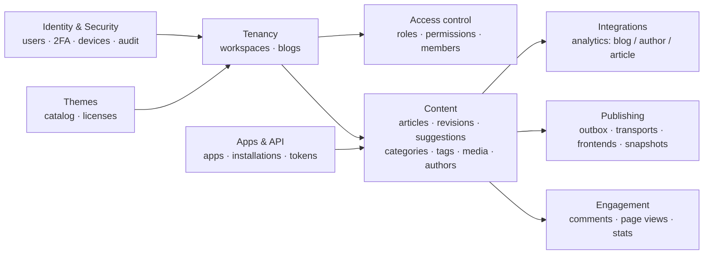
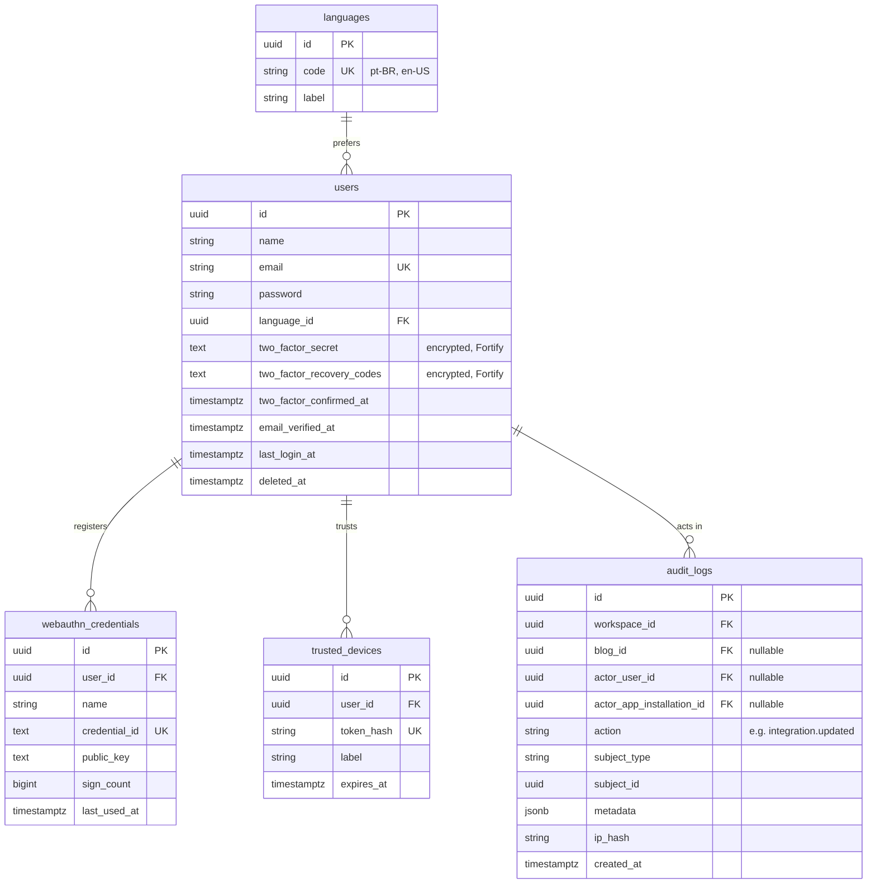
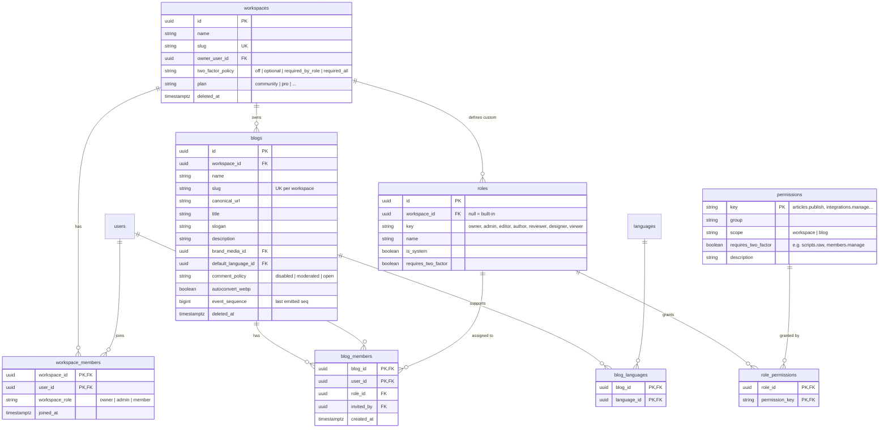
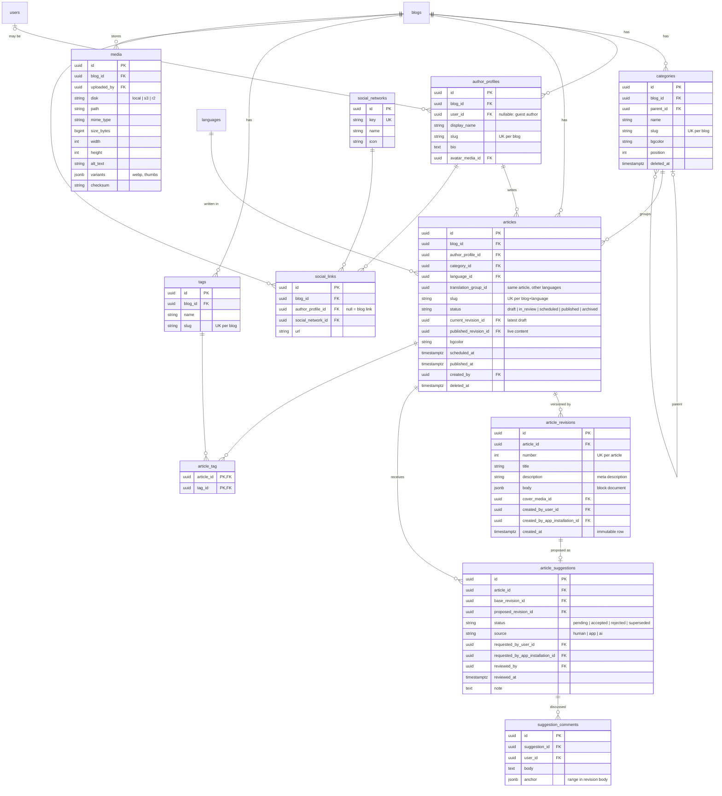
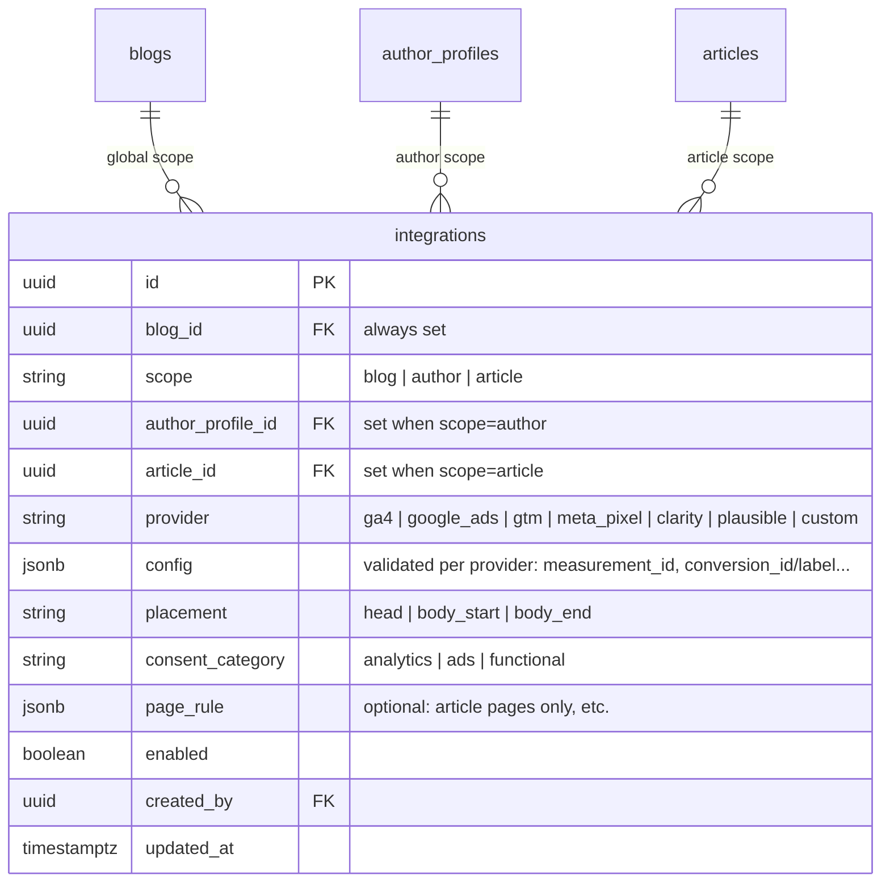
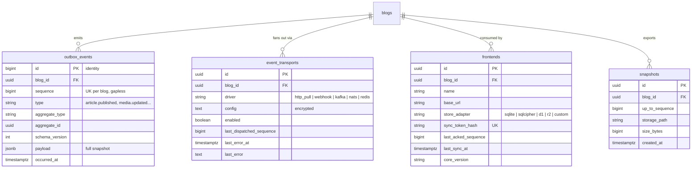
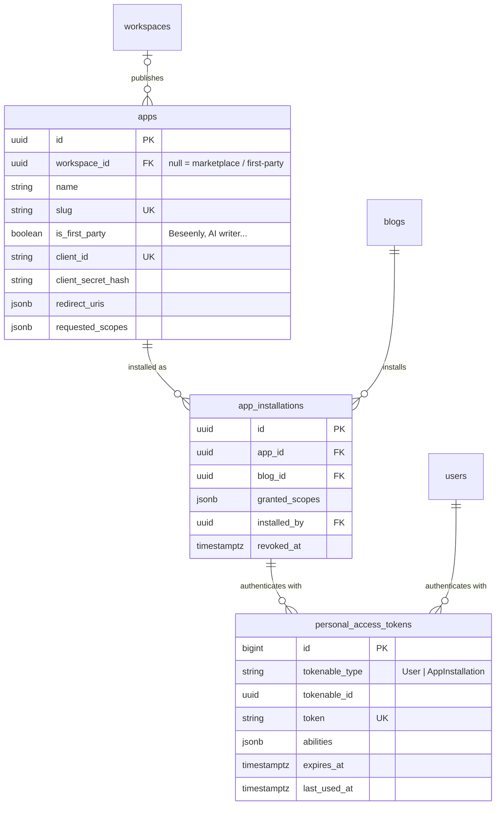
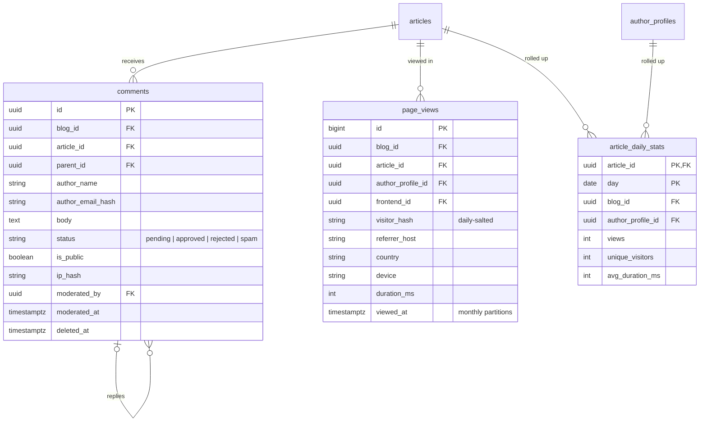
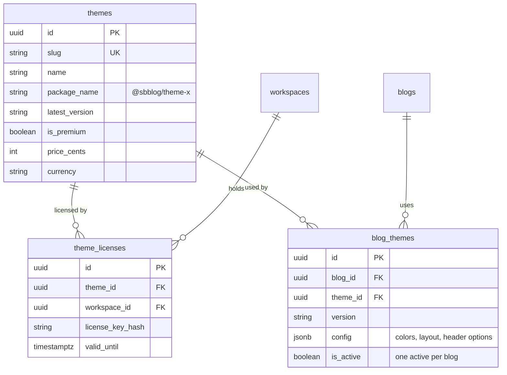

# SBBlog v2 — Console ERD

This is the **write-side** schema: the console database (PostgreSQL). The read-side store used by
frontends (SQLite / SQLCipher / D1 / R2) is defined by the event schema, not by this ERD.

## Design rules

1. **PostgreSQL only.** v1 already depends on `jsonb` and `timestamptz`.
2. **UUIDv7 primary keys** for every entity that leaves the console (articles, media, authors…).
   The same ID is used in events, the API and every frontend store. Exception: `outbox_events`
   uses a `bigint` identity.
3. **Every tenant table carries `blog_id`** (or `workspace_id`). Queries are always scoped and
   nothing references across blogs.
4. **Content is versioned.** `articles` holds identity and state, `article_revisions` holds the
   content and is immutable. Edits create revisions, and suggestions point to revisions.
5. **No change without an event.** Each publish-relevant write inserts into `outbox_events` in the
   **same transaction**.
6. **All times are `timestamptz`.** Soft deletes only where restore is a product feature
   (articles, categories, comments, blogs, users).
7. **No raw IPs at rest.** Visitors are identified by a daily-salted hash (LGPD/GDPR).

## Domains



---

## 1. Identity & security



- Phase 1 includes the Fortify 2FA columns, but 2FA stays **unused** until it ships.
- `webauthn_credentials` (passkeys) and `trusted_devices` are for a later phase. They are included
  here so authentication has a single home from the start.

## 2. Tenancy & access control



- **2FA is enforced if any of these is true:** the workspace policy is `required_all`, the user's
  role has `requires_two_factor`, or the action's permission has `requires_two_factor`.
  The permission flag applies even when the workspace policy is `off`.
- Built-in roles have `workspace_id = null` and can't be edited. A custom role is a workspace-owned
  set of permissions (a paid feature).

## 3. Content



- **Authors are `author_profiles`, not users.** This allows guest authors without accounts and
  per-blog author pages, and gives author-scope analytics a clear owner.
- **Publishing:** set `published_revision_id = current_revision_id`, set `status = published`, and
  emit `article.published` with the full rendered snapshot. A scheduled article is published by a
  job at `scheduled_at`.
- **Accepting a suggestion** creates a new revision on top of the latest one. If `base_revision_id`
  is no longer current, the suggestion must be rebased or marked `superseded`.
- AI and external apps can only create `article_suggestions` or draft revisions. They never set
  `published_revision_id`.

## 4. Integrations (analytics, ads, structured scripts)



Check constraints:

```sql
CHECK (
  (scope = 'blog'    AND author_profile_id IS NULL AND article_id IS NULL) OR
  (scope = 'author'  AND author_profile_id IS NOT NULL AND article_id IS NULL) OR
  (scope = 'article' AND article_id IS NOT NULL AND author_profile_id IS NULL)
)
CHECK (provider <> 'custom' OR scope = 'blog')   -- raw scripts: global only
```

- `custom` (raw script) needs the `scripts.raw` permission, which has `requires_two_factor = true`.
- **Effective scripts for a page** = blog + that author's + that article's integrations,
  deduplicated by `(provider, config id)`. A single gtag loader serves every GA4/Ads ID.
- Any change emits `integrations.updated` for its scope. Frontends resolve the scripts at render
  time.

## 5. Publishing pipeline



- `sequence` comes from `blogs.event_sequence`, read with `SELECT … FOR UPDATE` in the same
  transaction as the content write. This keeps it gapless and ordered per blog.
- `http_pull` is always available: `GET /sync?after={sequence}`, authenticated by the frontend's
  sync token. Other transports are push copies of the same log.
- A new frontend loads the latest `snapshot`, then pulls events after `up_to_sequence`. Old events
  can be pruned after a snapshot is taken.
- `frontends.last_acked_sequence` drives the "frontend X is behind" view in the console.

## 6. Apps & API



- `personal_access_tokens` is Laravel Sanctum's table, made polymorphic over users and app
  installations.
- Each app installation is **scoped to one blog**. App writes are recorded in
  `article_revisions.created_by_app_installation_id` and `audit_logs`.

## 7. Engagement (written back from frontends)



- Frontends are read-only, so comments and views are **POSTed to the console API**. An approved
  comment emits `comment.approved` and reaches the frontend through the normal event flow.
- `page_views` is raw and partitioned by month, with short retention. `article_daily_stats` is
  the rollup used by the blog and per-author dashboards.

## 8. Themes



---

## v1 → v2 mapping

| v1 | v2 | Notes |
|---|---|---|
| `users` | `users` + `workspace_members` + `blog_members` + `author_profiles` | Each v1 user becomes an Admin of the migrated blog and gets an author profile |
| `generals` | `blogs` | title, slogan, description, brand image → `brand_media_id`, `autoconvert_webp` |
| `generals.google_analytics` | `integrations` (ga4, scope blog) | |
| `generals.google_ads_script` | `integrations` (google_ads or custom, scope blog) | Parse into a structured config where possible |
| `generals.google_optimize_script` | dropped | Google Optimize was shut down in 2023 |
| `comment_configs` | `blogs.comment_policy` | The lookup table becomes an enum |
| `categories` | `categories` | + `blog_id`, `slug`, `parent_id` |
| `articles` | `articles` + `article_revisions` | title, description and body move to revision #1. `url_friendly` → `slug`, `premiere_date` → `scheduled_at` / `published_at`, `cover_path` → `media` |
| `article_tags` (free text) | `tags` + `article_tag` | Normalized and unique per blog |
| `article_comments` | `comments` | `authorized_public` → `status`; raw IP → `ip_hash` |
| `article_visits` | `page_views` + `article_daily_stats` | Raw IPs and user agents are dropped |
| `languages` | `languages` + `blog_languages` | |
| `social_networks`, `social_network_urls` | `social_networks`, `social_links` | Links can also belong to authors |

## Open questions

1. **Article body format:** a JSON block document (recommended, since any frontend can render it)
   or HTML as in v1? This decides how much rendering moves into `@sbblog/core`.
2. **Cross-workspace authors:** can one person author in two workspaces? The model allows it
   (one user, many `author_profiles`), but should billing count them once or per workspace?
3. **Analytics hosting:** should `page_views` live in Postgres, or go to a separate store
   (ClickHouse / Tinybird) for larger installs, with only the rollup kept here?
